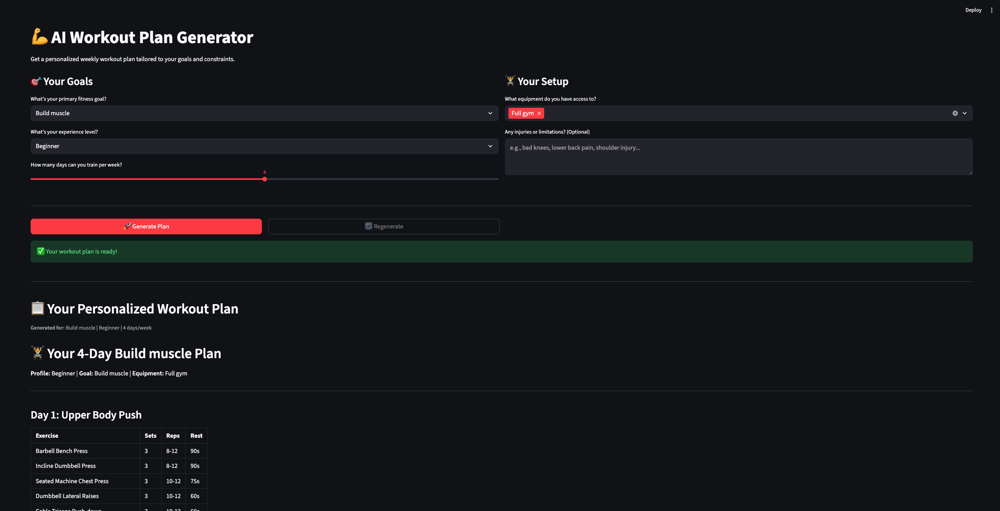

# AI Workout Plan Generator

A Streamlit app that generates personalized weekly workout plans using the Groq LLM API.

**Assignment:** Codebasics AI Engineering Cohort - Session 2

## Features

- **Personalized Plans:** Generates workout plans based on your goals, experience, and available equipment
- **Respects Constraints:** Plans only include exercises you can do with your available equipment
- **Injury-Aware:** Avoids exercises that could aggravate reported injuries/limitations
- **Structured Output:** Day-by-day breakdown with exercises, sets, reps, and rest times
- **Download:** Save your plan as a Markdown file
- **Swap Exercises:** Don't like an exercise? Get an alternative with one click

## Architecture

```
┌─────────────────────────────────────────────────────────────────────────────┐
│                              STREAMLIT UI                                    │
│  ┌─────────────────────────────┐    ┌─────────────────────────────┐         │
│  │      LEFT COLUMN            │    │      RIGHT COLUMN           │         │
│  │  ┌───────────────────────┐  │    │  ┌───────────────────────┐  │         │
│  │  │ Fitness Goal ▼        │  │    │  │ Equipment ☑ ☑ ☐ ☑     │  │         │
│  │  │ Experience Level ▼    │  │    │  │ Injuries [________]   │  │         │
│  │  │ Days/Week [====●===]  │  │    │  │                       │  │         │
│  │  └───────────────────────┘  │    │  └───────────────────────┘  │         │
│  └─────────────────────────────┘    └─────────────────────────────┘         │
│                                                                              │
│  ┌──────────────────┐  ┌──────────────────┐                                 │
│  │ 🚀 Generate Plan │  │ 🔄 Regenerate    │                                 │
│  └────────┬─────────┘  └────────┬─────────┘                                 │
└───────────┼─────────────────────┼───────────────────────────────────────────┘
            │                     │
            └──────────┬──────────┘
                       ▼
┌─────────────────────────────────────────────────────────────────────────────┐
│                           INPUT VALIDATION                                   │
│                                                                              │
│   ✓ Equipment selected?    ✓ Days between 1-7?    ✓ API key exists?        │
│                                                                              │
│   If invalid → Show error message and STOP                                  │
└─────────────────────────────────────────────────────────────────────────────┘
                       │
                       ▼
┌─────────────────────────────────────────────────────────────────────────────┐
│                          INPUT SANITIZATION                                  │
│                                                                              │
│   sanitize_input(injuries)                                                   │
│     • Remove HTML tags                                                       │
│     • Block prompt injection phrases                                         │
│     • Truncate to max length                                                 │
└─────────────────────────────────────────────────────────────────────────────┘
                       │
                       ▼
┌─────────────────────────────────────────────────────────────────────────────┐
│                           PROMPT BUILDER                                     │
│                                                                              │
│   ┌─────────────────────────────────────────────────────────────────────┐   │
│   │  USER PROFILE: Goal, Level, Days, Equipment, Injuries              │   │
│   │  STRICT REQUIREMENTS: Exact days, equipment-only exercises         │   │
│   │  OUTPUT FORMAT: Day-by-day tables with sets/reps/rest              │   │
│   │  INJURY DISCLAIMER: If injuries provided                           │   │
│   └─────────────────────────────────────────────────────────────────────┘   │
└─────────────────────────────────────────────────────────────────────────────┘
                       │
                       ▼
┌─────────────────────────────────────────────────────────────────────────────┐
│                              GROQ API                                        │
│                                                                              │
│   ┌─────────────┐      HTTP Request       ┌─────────────────────────┐       │
│   │   app.py    │ ───────────────────────▶│   Groq Cloud            │       │
│   │             │                          │   (LLM: gpt-oss-120b)   │       │
│   │             │ ◀─────────────────────── │                         │       │
│   └─────────────┘      JSON Response       └─────────────────────────┘       │
│                                                                              │
│   try/except handles: Auth errors, Rate limits, Network issues              │
└─────────────────────────────────────────────────────────────────────────────┘
                       │
                       ▼
┌─────────────────────────────────────────────────────────────────────────────┐
│                          RESPONSE HANDLING                                   │
│                                                                              │
│   ✓ Response not empty?    ✓ Content exists?                                │
│                                                                              │
│   If empty → Show fallback error message                                    │
└─────────────────────────────────────────────────────────────────────────────┘
                       │
                       ▼
┌─────────────────────────────────────────────────────────────────────────────┐
│                           SESSION STATE                                      │
│                                                                              │
│   st.session_state["workout_plan"] = response                               │
│   st.session_state["plan_settings"] = {goal, level, days, equipment}        │
│                                                                              │
│   Plan persists even when user interacts with other widgets                 │
└─────────────────────────────────────────────────────────────────────────────┘
                       │
                       ▼
┌─────────────────────────────────────────────────────────────────────────────┐
│                            DISPLAY OUTPUT                                    │
│                                                                              │
│   ┌─────────────────────────────────────────────────────────────────────┐   │
│   │  📋 Your Personalized Workout Plan                                  │   │
│   │  ┌───────────────────────────────────────────────────────────────┐  │   │
│   │  │ Day 1: Upper Body Push                                        │  │   │
│   │  │ ┌──────────────┬──────┬──────┬──────┐                         │  │   │
│   │  │ │ Exercise     │ Sets │ Reps │ Rest │                         │  │   │
│   │  │ ├──────────────┼──────┼──────┼──────┤                         │  │   │
│   │  │ │ Bench Press  │  4   │ 8-12 │ 90s  │                         │  │   │
│   │  │ └──────────────┴──────┴──────┴──────┘                         │  │   │
│   │  └───────────────────────────────────────────────────────────────┘  │   │
│   └─────────────────────────────────────────────────────────────────────┘   │
│                                                                              │
│   ┌───────────────────┐    ┌─────────────────────────────────────────────┐  │
│   │ 📥 Download (.md) │    │ 🔄 Swap Exercise: [___________] [Get Alt]  │  │
│   └───────────────────┘    └─────────────────────────────────────────────┘  │
└─────────────────────────────────────────────────────────────────────────────┘
```

## Screenshots



**Features shown:**
1. Input form on the left (goals, experience level)
2. Equipment and injury inputs on the right
3. Generated workout plan with tables
4. Download and swap exercise features

## Setup

### Prerequisites
- Python 3.10+
- Groq API Key (get one free at [console.groq.com](https://console.groq.com/keys))
- uv (fast Python package manager)

### Step 1: Install uv (if not already installed)

```bash
# Install uv
wget -qO- https://astral.sh/uv/install.sh | sh

# Add to PATH
source $HOME/.local/bin/env

# Verify installation
uv --version
```

### Step 2: Clone and Setup

```bash
# Clone the repository
git clone <your-repo-url>
cd Session2_Assignment

# Create virtual environment
uv venv

# Activate virtual environment
source .venv/bin/activate  # On Windows: .venv\Scripts\activate

# Install dependencies
uv pip install -r requirements.txt
```

### Step 3: Configure Environment Variables

Create a `.env` file in the project root:
```
GROQ_API_KEY=your_groq_api_key_here
GROQ_MODEL=openai/gpt-oss-120b
```

### Step 4: Run the App

```bash
streamlit run app.py
```

Open in browser: `http://localhost:8501`

## Usage

1. **Select your fitness goal:** Build muscle, Lose fat, General fitness, or Improve endurance
2. **Choose your experience level:** Beginner, Intermediate, or Advanced
3. **Set available training days:** Use the slider (1-7 days)
4. **Select your equipment:** Choose all equipment you have access to
5. **Add any injuries (optional):** e.g., "bad knees", "shoulder injury"
6. **Click "Generate Plan"**

### Additional Features

- **Regenerate:** Click to get a different variation of your plan
- **Download:** Save your plan as a `.md` file
- **Swap Exercise:** Enter an exercise name to get an alternative

## Project Structure

```
Session2_Assignment/
├── app.py                      # Main Streamlit application
├── requirements.txt            # Python dependencies
├── .env                        # Environment variables (not in repo)
├── .gitignore                  # Git ignore rules
├── README.md                   # This file
├── images/
│   └── Workout_Generator_UI_Screenshot.jpg
└── docs/
    └── AI Engineering Cohort - Assignment.pdf
```

## Tech Stack

- **Python 3.10+**
- **Streamlit** - Web UI framework
- **Groq API** - LLM inference
- **python-dotenv** - Environment variable management
- **uv** - Fast Python package manager

## Error Handling

The app handles common errors gracefully:
- Missing API key → Friendly configuration message
- Invalid API key → Authentication error message
- Network issues → Connection error message
- Rate limiting → "Please wait" message
- Empty responses → Fallback error message

## Security

- Input sanitization to prevent prompt injection
- No API keys exposed in code
- `.env` file excluded from git

## Assignment Rubric Coverage

| Criteria | Weight | Status |
|----------|--------|--------|
| App runs without crashing on invalid input | 20% | ✅ |
| Structured inputs passed correctly | 25% | ✅ |
| Prompt design respects constraints | 30% | ✅ |
| Error handling | 15% | ✅ |
| Code quality (type hints, functions) | 10% | ✅ |

## Stretch Goals Implemented

- [x] Regenerate button
- [x] Session state persistence
- [x] Download as .md file
- [x] Swap exercise feature

## Author

**Himesh Sarkari**

Built as part of the Codebasics AI Engineering Cohort - Session 2 Assignment.
